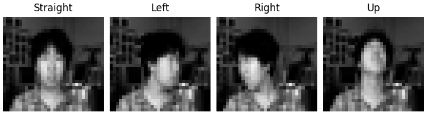

CMU Face Images
===============

This builder loads the 624 valid quarter-resolution grayscale images from
CMU Face Images. The supervised task is four-class head-pose classification.
Other resolutions are excluded, and the source-marked bad images are omitted.

Source
------

* Homepage: https://archive.ics.uci.edu/dataset/124/cmu+face+images
* DOI: https://doi.org/10.24432/C5JC79
* License: CC BY 4.0, as stated by UCI; distinct from the code license.
* Citation: Mitchell, T. (1997). CMU Face Images. UCI Machine Learning Repository.
* ZIP SHA-256: ``01a8b6cc58ac2f825f72abd6cf2b393df067c6529d96f7a90b22dede71b142cc``.

Fields and labels
-----------------

* ``image``: grayscale PIL image, width 32 and height 30.
* ``label``: head pose, ``0=straight``, ``1=left``, ``2=right``, ``3=up``.
* ``subject``: original person identifier.
* ``expression``: ``0=neutral``, ``1=happy``, ``2=sad``, ``3=angry``.
* ``eyes``: ``0=open``, ``1=sunglasses``.

Custom split
------------

The fixed split holds out entire people. It is not an official CMU protocol.
Subjects are assigned in the original documented order:

* Train: 378 images from an2i, at33, boland, bpm, ch4f, cheyer, choon,
  danieln, glickman, karyadi, kawamura and kk49.
* Validation: 121 images from megak, mitchell, night and phoebe.
* Test: 125 images from saavik, steffi, sz24 and tammo.

Only 20 people are available, including four test identities. Results on this
custom split do not establish generalization to a broad population.

Usage
-----

Install this contribution's source checkout with ``python -m pip install -e .``.
Use a main guard when saving the example as a Windows script:

.. code-block:: python

    from stable_datasets.images import CMUFaces

    def main():
        data = CMUFaces()
        print({name: len(split) for name, split in data.items()})
        sample = data["train"][0]
        print(sample["image"].size, sample["label"], sample["subject"])

    if __name__ == "__main__":
        main()

``CMUFaces(split="train")`` returns one split. Optional ``download_dir`` and
``processed_cache_dir`` relocate raw and processed caches. Shared split assets
are downloaded once. Images preserve their original grayscale pixels.

Validation and experiments
--------------------------

Offline tests cover parsing, all label combinations, malformed metadata,
subject routing, cache reuse and public exports. Real-data tests check counts,
all 624 image decodes and disjoint identities. ``CMU_FACES_ARCHIVE`` enables
the real-archive tests; they skip if the variable is absent.

.. code-block:: text

    python -m pytest stable_datasets/tests/test_cmu_faces.py stable_datasets/tests/test_cmu_faces_offline.py -q
    python -m pytest stable_datasets/tests/test_cmu_benchmark.py -q

The training protocol, three-seed SimCLR results, two supervised task baselines,
confusion matrices and limitations are documented in
``benchmarks/reports/cmu_faces/README.md`` in the source checkout. The image
loader retains native resolution; benchmark transforms resize images to 64x64.
